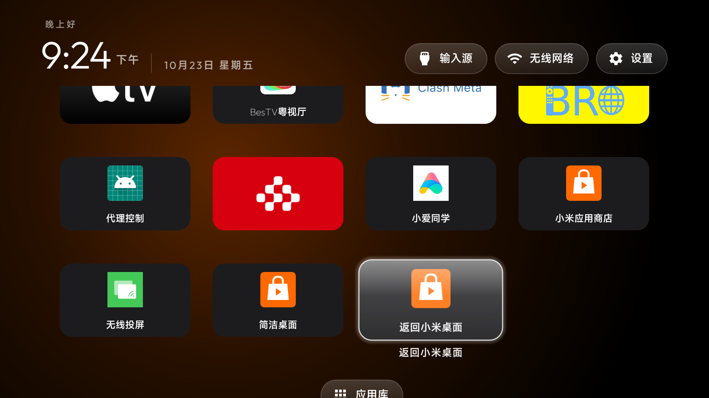

# Xiaomi TV Proxy Switcher

## 中文说明

这是一个面向 Android TV 的 HTTP 代理控制应用，适用于需要在多台手机或多个代理之间快速切换的电视。

功能：

- 预设最多 4 组代理；
- 每组包含设备备注、IP 地址和端口；
- “保存”只保存预设；“使用”保存并立即启用；
- 右上角红/绿状态灯显示代理是否启用；
- 顶部显示当前生效的设备备注和代理地址；
- 自动修正常见中文点号 `·`、`．`、`。`，避免 IP 地址输入错误。

应用通过 Android `Settings.Global` 修改 `http_proxy`。首次安装后需要使用 ADB 授予 `WRITE_SECURE_SETTINGS`：

```bash
adb install -r proxy-switcher.apk
adb shell pm grant local.proxy.switcher android.permission.WRITE_SECURE_SETTINGS
```

电视系统必须允许该权限；普通未授权应用不能修改全局代理。应用只配置 HTTP 代理，不提供 VPN，也不会保存代理密码。

## English

Xiaomi TV Proxy Switcher is an Android TV application for switching between HTTP proxies hosted by multiple phones or devices.

Features:

- Up to four saved proxy presets;
- Device label, IP address, and port for every preset;
- **Save** stores a preset; **Use** stores and activates it;
- Red/green status indicator in the top-right corner;
- The active device label and proxy address are shown at the top;
- Common Chinese punctuation characters (`·`, `．`, `。`) are normalized to `.` in IP addresses.

The app updates Android `Settings.Global` key `http_proxy`. After installation, grant the required permission with ADB:

```bash
adb install -r proxy-switcher.apk
adb shell pm grant local.proxy.switcher android.permission.WRITE_SECURE_SETTINGS
```

The TV firmware must allow this permission. The app configures HTTP proxy settings only; it does not implement VPN and does not store proxy credentials.

## Build

Open this directory with Android Studio or run:

```bash
./gradlew assembleRelease
```

The project targets Android API 34 and supports Android 9/API 28 and newer.

## License / 许可证

### 简洁桌面快捷方式

`launcher-shortcut/` 是一个可从电视应用列表手动打开的快捷方式。它启动已安装的 `com.gathin.tvhome` 简洁桌面，不修改系统默认桌面，适合电视重启后恢复桌面。

```bash
cd launcher-shortcut
./build.sh
adb install -r launcher-shortcut.apk
```

### 桌面恢复快捷方式

`stock-home-shortcut/` 提供“返回小米桌面”应用。它用于需要临时返回小米原生桌面、检查系统设置或处理兼容性问题的情况。点击后会关闭简洁桌面的 Home 辅助接管，并启动小米原生桌面；不会修改 HDMI1 开机输入设置。

如果需要再次使用简洁桌面，打开“简洁桌面”应用即可。两个快捷方式都保留在电视应用列表中，方便在桌面接管异常时恢复。

**Desktop recovery shortcut (English):** `stock-home-shortcut/` adds the **Return to Xiaomi Desktop** app. Use it to temporarily open the original Xiaomi desktop for settings or compatibility checks. It disables the clean launcher's Home helper and starts Xiaomi's desktop without changing the HDMI1 startup input. Open **简洁桌面** again to return to the clean launcher.

MIT License. See [LICENSE](LICENSE). Contributions are welcome through forks
and pull requests; see [CONTRIBUTING.md](CONTRIBUTING.md).

### 界面示例



截图展示了电视上的 Apple TV 风格简洁桌面；底部应用位和应用列表可按个人安装情况调整。
