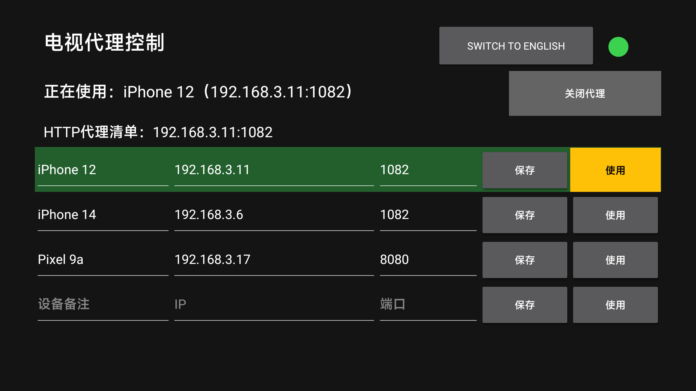
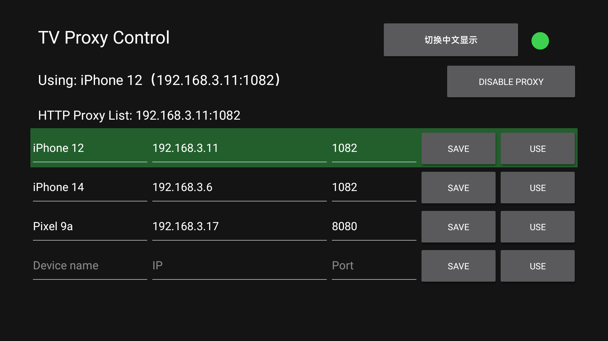

# 小米电视代理切换器

[English README](README.md)

## 中文说明

这是一个面向 Android TV 的 HTTP 代理控制应用，适用于需要在多台手机或多个代理之间快速切换的电视。

功能：

- 预设最多 4 组代理；
- 每组包含设备备注、IP 地址和端口；
- “保存”只保存预设；“使用”保存并立即启用；
- 右上角红/绿状态灯显示代理是否启用；
- 顶部显示当前生效的设备备注和代理地址；
- 自动修正常见中文点号 `·`、`．`、`。`，避免 IP 地址输入错误。

应用通过 Android `Settings.Global` 修改 `http_proxy`。首次安装后需要使用 ADB 授予 `WRITE_SECURE_SETTINGS`：

```bash
adb install -r proxy-switcher.apk
adb shell pm grant local.proxy.switcher android.permission.WRITE_SECURE_SETTINGS
```

电视系统必须允许该权限；普通未授权应用不能修改全局代理。应用只配置 HTTP 代理，不提供 VPN，也不会保存代理密码。

## English

Xiaomi TV Proxy Switcher is an Android TV application for switching between HTTP proxies hosted by multiple phones or devices.

Features:

- Up to four saved proxy presets;
- Device label, IP address, and port for every preset;
- **Save** stores a preset; **Use** stores and activates it;
- Red/green status indicator in the top-right corner;
- The active device label and proxy address are shown at the top;
- Common Chinese punctuation characters (`·`, `．`, `。`) are normalized to `.` in IP addresses.

The app updates Android `Settings.Global` key `http_proxy`. After installation, grant the required permission with ADB:

```bash
adb install -r proxy-switcher.apk
adb shell pm grant local.proxy.switcher android.permission.WRITE_SECURE_SETTINGS
```

The TV firmware must allow this permission. The app configures HTTP proxy settings only; it does not implement VPN and does not store proxy credentials.

## Build

Open this directory with Android Studio or run:

```bash
./gradlew assembleRelease
```

The project targets Android API 34 and supports Android 9/API 28 and newer.

## License / 许可证

### 简洁桌面快捷方式

`launcher-shortcut/` 是一个可从电视应用列表手动打开的快捷方式。它启动已安装的 `com.gathin.tvhome` 简洁桌面，不修改系统默认桌面，适合电视重启后恢复桌面。

```bash
cd launcher-shortcut
./build.sh
adb install -r launcher-shortcut.apk
```

### 鼠标连接说明

这台 MiTV-ASTP0 的系统界面可能没有可用的蓝牙功能。推荐使用 USB 鼠标或 **2.4G 无线鼠标**：将无线鼠标的 USB 接收器插入电视 USB 口，等待几秒即可使用，通常不需要额外驱动。

**Mouse connection:** Bluetooth may be unavailable on this MiTV-ASTP0 firmware. A wired USB mouse or a 2.4 GHz wireless mouse with its USB receiver is recommended. Plug the receiver into the TV's USB port and wait a few seconds for Android TV to recognize it.

### 界面示例



截图展示了代理状态、当前使用的代理备注、代理清单、中文/English 切换按钮，以及正在使用代理的整行高亮效果。

英文界面：



MIT License. See [LICENSE](LICENSE). Contributions are welcome through forks
and pull requests; see [CONTRIBUTING.md](CONTRIBUTING.md).

